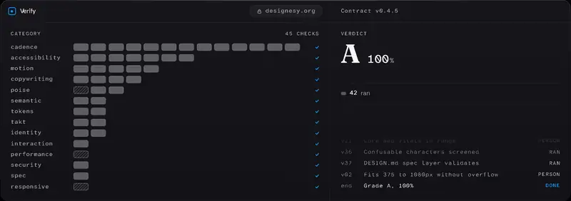

# Designesy

[](https://pypi.org/project/designesy-mcp/)
[](https://www.npmjs.com/package/@designesy/score)
[](https://registry.modelcontextprotocol.io/v0.1/servers/io.github.LE-VAI%2Fdesignesy-org/versions/latest)
[](https://smithery.ai/servers/le-vai/designesy)
[](https://glama.ai/mcp/servers/LE-VAI/designesy-org)
[](LICENSE)

<picture>
  <source media="(prefers-reduced-motion: reduce)" srcset="docs/media/verify-loop-poster.png">
  
</picture>
<p><sub>A 12-second loop, recorded from the homepage. It plays once and rests on the verdict, and shows a still frame if you prefer reduced motion. <a href="https://www.designesy.org/">Watch it run on designesy.org</a>.</sub></p>

Design quality gate for AI-generated UI: score any URL on 45 deterministic checks, A–F grade. Live at [designesy.org](https://www.designesy.org).

## Quick Start

**Score any URL in 5 seconds — no install:**

```bash
npx @designesy/score@latest https://your-site.com
```

**Add to Claude Desktop, Cursor, or any MCP client:**

```bash
# Claude Code, remote (zero install, no auth):
claude mcp add --transport http designesy https://www.designesy.org/api/mcp

# Or local stdio via PyPI:
pip install designesy-mcp && designesy-mcp
```

**Clone this repo?** The `.mcp.json` at root adds the local server (`uvx designesy-mcp`) to Claude Code as a project server. Claude Code asks you to approve it the first time you open the project. It needs [uv](https://docs.astral.sh/uv/).

**Gate your CI on design-contract compliance:**

```yaml
- uses: LE-VAI/designesy-org@v1
  with:
    url: https://your-app.vercel.app
    min-score: 70
    min-grade: C
    post-comment: true   # posts a summary comment on PRs (default)
```

The same 45-check engine powers an MCP server (17 tools for AI agents), a CLI with no required dependencies (`npx @designesy/score`), and a GitHub Action.

**Designesy Contract Check** is a GitHub Action that scores any URL against a **45-check design-system contract** (tokens, motion, accessibility, cadence, takt, poise, identity, interaction, performance, responsive, semantic, security, spec, copywriting) and fails your CI workflow when the score or grade drops below your threshold. No LLM in the loop: every check is a published, deterministic rule, so the same page gives the same verdicts.

## Tools

- `designesy_score` — Score a live URL against the 45-check design contract. Returns score, grade (A–F), and per-check breakdown.
- `designesy_tokens_score` — Validate a DTCG design-token file. 10 conformance checks against W3C DTCG 2025.10.
- `designesy_a11y_score` — Get the WCAG 2.2 AA accessibility framework and Playwright/axe-core script template.
- `designesy_motion_score` — Validate a Lottie animation file. 10 checks against Lottie spec v1.0.1 and §16 motion standards.
- `designesy_contract` — Get the design-system contract (tokens, motion, takt, cadence, typography, verification), whole or only the top-level `sections` you name.
- `designesy_catalog` — List the published Designesy packages with versions and URLs (the count comes back in `package_count`).
- `designesy_design_review` — Get the 8-dimension qualitative design review rubric.
- `designesy_skill_md` — Get the contract as an agent-skill-format SKILL.md for Cursor, Claude Code, or Replit.
- `designesy_agent_json` — Get the /.well-known/agent.json discovery document.
- `designesy_llms_txt` — Get the short /llms.txt agent brief.
- `designesy_llms_full_txt` — Get the full /llms-full.txt brief as reference data (its ingest steps and paste-ready agent prompt stay in the published file).
- `designesy_drift_score` — Score a live URL for UI drift: 12 checks on its custom properties and var() references.
- `designesy_readiness_score` — Score a URL for AI readiness: 10 probes for machine-readable design artifacts (DTCG tokens, llms.txt, agent.json, an MCP endpoint, DESIGN.md and more).
- `designesy_guardrails` — Generate a build-contract bundle for coding agents from a site's tokens: DTCG tokens, Stylelint config, AGENTS.md rules, component contract, anti-patterns and DESIGN.md.
- `designesy_monitor_score` — Re-run the drift checks against earlier snapshots and compute 10 monitor checks; can send a drift-alert email to an address you pass.
- `designesy_compare` — Diff the tokens of two live URLs: added, removed, renamed, changed values, scale and contrast drift, and the score delta.
- `designesy_report` — One composite report for a URL (score × 0.5 + drift × 0.3 + readiness × 0.2), with an interactive dashboard in hosts that support MCP Apps.

### Tool reference table

| Tool | Description |
|---|---|
| `designesy_score` | Score a live URL against the 45-check design contract — returns score, grade (A–F), per-check breakdown |
| `designesy_tokens_score` | Validate a DTCG design-token file (10 conformance checks, W3C DTCG 2025.10) |
| `designesy_a11y_score` | Get the WCAG 2.2 AA accessibility framework + Playwright/axe-core script template |
| `designesy_motion_score` | Validate a Lottie animation file (10 checks, Lottie spec v1.0.1 + §16 motion standards) |
| `designesy_contract` | Get the design-system contract (tokens, motion, takt, cadence, typography, verification), whole or only the top-level `sections` you name |
| `designesy_catalog` | List the published Designesy packages with versions and URLs |
| `designesy_design_review` | Get the 8-dimension qualitative design review rubric |
| `designesy_skill_md` | Get the contract as an agent-skill-format SKILL.md (for Cursor/Claude Code/Replit) |
| `designesy_agent_json` | Get the /.well-known/agent.json discovery document |
| `designesy_llms_txt` | Get the short /llms.txt agent brief |
| `designesy_llms_full_txt` | Get the full /llms-full.txt brief as reference data (its ingest steps and paste-ready agent prompt stay in the published file) |
| `designesy_drift_score` | Score a live URL for UI drift (12 checks on custom properties and var() references) |
| `designesy_readiness_score` | Score a URL for AI readiness (10 probes for machine-readable design artifacts) |
| `designesy_guardrails` | Generate a build-contract bundle for coding agents from a site's tokens (6 files) |
| `designesy_monitor_score` | Re-run drift checks against earlier snapshots; 10 monitor checks; optional drift-alert email |
| `designesy_compare` | Diff the tokens of two live URLs, with the score delta |
| `designesy_report` | Composite report for one URL (score, drift, readiness), with an MCP App dashboard |

## Live

- **Site:** [designesy.org](https://www.designesy.org)
- **MCP endpoint:** [designesy.org/api/mcp](https://www.designesy.org/api/mcp) (Streamable HTTP, no auth)
- **Score a site:** [designesy.org/score](https://www.designesy.org/score)
- **Methodology:** [designesy.org/methodology](https://www.designesy.org/methodology) — full 45-check scoring methodology
- **Contract:** [designesy.org/contracts/design-system](https://www.designesy.org/contracts/design-system)
- **Machine export:** [designesy.org/contracts/design-system.json](https://www.designesy.org/contracts/design-system.json)

## Contract verification

[](https://www.designesy.org/score/report?url=designesy.org) [](https://www.designesy.org/score/report?url=designesy.org)

The live site is verified against the design system contract — 45 deterministic checks with provenance back to tokens. Both badges read the site's own recorded score from `/api/badge?site=designesy.org`, which carries the date it was measured; for a fresh reading with every check, [score designesy.org now](https://www.designesy.org/score/report?url=designesy.org). See the [methodology page](https://www.designesy.org/methodology) for how the score is computed.

## The contract

- **45 verification checks** across 14 weighted categories — tokens, motion, accessibility, cadence, takt, poise, identity, interaction, performance, responsive, semantic, security, spec, copywriting
- **Copywriting principles** (added in v0.4.0) — 16 UX copy principles + 4 verification checks (button verb phrases, no trailing periods, descriptive link text, no ALL CAPS)
- **10 Non-Negotiable Motion Standards** — deliberate easing, explicit properties, opacity entrances, keyboard stillness, no layout animation, touch gating, bounded duration, reduced-motion paths, asymmetric press, no ease-in
- **10 acoustic cue tokens** — custom `$type: sound` (net-new vs W3C DTCG 2025.10), Cuelume 0.2 engine (MIT), interaction-only. The [acoustic token document](https://www.designesy.org/acoustic-tokens) adds 9 extended feedback cues, 19 in all
- **10 open tensions** — documented, not hidden
- **Spring physics** — default + momentum tokens via custom `$type: spring`
- **Machine-readable** — W3C DTCG 2025.10 format + custom extensions

See the [contract page](https://www.designesy.org/contracts/design-system) for the full adoption history.

## GitHub Action

Gate your CI on design-contract compliance:

```yaml
- uses: LE-VAI/designesy-org@v1
  with:
    url: https://your-app.vercel.app
    min-score: 70
    min-grade: C
    post-comment: true   # posts a summary comment on PRs (default)
```

Scores a URL via the live `/api/score` engine and fails the workflow if the score or grade drops below your threshold. Runs on `node24`, posts PR comments via bare GitHub REST API (zero dependencies). See [`action/README.md`](action/README.md) for full usage.

## CLI

Score a URL from the command line — for local development, pre-commit hooks, or scripts:

```bash
# No install needed:
npx @designesy/score designesy.org

# With gating (exit 1 on failure):
npx @designesy/score linear.app --min-score 70 --min-grade B

# JSON output for piping:
npx @designesy/score vercel.com --format canonical --json
```

No required dependencies. The engine runs locally, with no Designesy server; the checks that need a browser return MANUAL. See `--help` for all options and [`packages/score/README.md`](packages/score/README.md) for the full reference.

**From a clone of this repo:** the engine's `dist/` folder is not committed, so build it first.

```bash
npm --prefix packages/score ci
npm run build:score
node packages/score/dist/cli.js designesy.org
```

The older `cli/designesy-score.mjs` (`npm run score`) reads the same build. It is superseded by `@designesy/score`. Its `--api` flag (or the `SCORE_API` env var) is an opt-in remote fallback that sends the URL to a scoring server instead of scoring locally; it is off by default.

## Repository

The site is a Next.js 16 App Router app (React 19, webpack build), deployed on Vercel. The npm packages and the MCP server live beside it.

```
apps/site                              the site, its API routes (/api/score, /api/mcp) and its build checks (scripts/)
packages/score                         @designesy/score: the scoring engine and CLI (npm)
packages/cli                           @designesy/cli: one CLI for tokens and score (npm)
packages/tokens                        @designesy/tokens: DTCG token validator (npm)
packages/stylelint-plugin-dtcg-tokens  @designesy/stylelint-plugin-dtcg-tokens (npm)
packages/lab-builder                   @designesy/lab-builder (npm)
packages/designesy-mcp                 designesy-mcp: the local stdio MCP server (PyPI)
packages/vai-icons, vai-motion         @vai/icons and @vai/motion (not yet published)
action.yml, action/dist                the Designesy Contract Check GitHub Action
cli/                                   designesy-score, the older CLI (superseded by @designesy/score)
scripts/                               repo-level scripts
docs/designesy                         founding notes from May 2026: mission, architecture, contracts, labs
DESIGN.md                              operating principles and agent rules (v0.1)
AGENTS.md                              agent operating rules
```

Contract mode, which scores a page against your own DESIGN.md or DTCG token file, is specified in [docs/contract-mode-spec.md](docs/contract-mode-spec.md).

The design contract in DESIGN.md format is generated from the contract source and served at [designesy.org/DESIGN.md](https://www.designesy.org/DESIGN.md). The root `DESIGN.md` file is the older v0.1 charter.

## What Designesy is not

Designesy is not a template gallery. Designesy is not a generic AI design tool. Designesy is not a moodboard.

Designesy is a system.

## Related tools

- **[Lyse](https://github.com/lyse-labs/lyse)** — 258-check design system health scoring from your codebase (6 axes). Designesy scores any public URL; Lyse scores your repo. Complementary.
- **[axe-core](https://github.com/dequelabs/axe-core)** — WCAG accessibility testing. Designesy checks design-contract compliance (tokens, motion, typography) — a different layer. They complement each other.
- **[Lighthouse](https://github.com/GoogleChrome/lighthouse)** — Performance, accessibility, and SEO auditing. Designesy checks design-contract compliance — Lighthouse doesn't know what a design token is.

## FAQ

**Does it need an API key?**
No. The MCP endpoint is stateless Streamable HTTP with no authentication. Sixteen of the 17 tools are read-only; `designesy_monitor_score` can send a drift-alert email to an address you pass.

**Is it deterministic?**
Yes. There is no LLM in the scoring loop: every check is deterministic and reproducible. The same page, engine and contract always produce the same verdicts, and the receipt's digest lets anyone check that. A live URL can change between runs, and results are cached for 24 hours.

**What does it score against?**
The current Designesy design-system contract — 45 checks across 14 weighted categories (tokens, motion, accessibility, cadence, takt, poise, identity, interaction, performance, responsive, semantic, security, spec, copywriting).

**Can I use it in CI?**
Yes. The [GitHub Action](#github-action) gates your workflow on contract compliance — fail the build if the score drops below your threshold.

**Where is the contract published?**
At [designesy.org/contracts/design-system](https://www.designesy.org/contracts/design-system) (human-readable) and [designesy.org/contracts/design-system.json](https://www.designesy.org/contracts/design-system.json) (machine-readable, W3C DTCG 2025.10).

## License

MIT — see [LICENSE](LICENSE). The contract is public; the code is open-source under MIT.